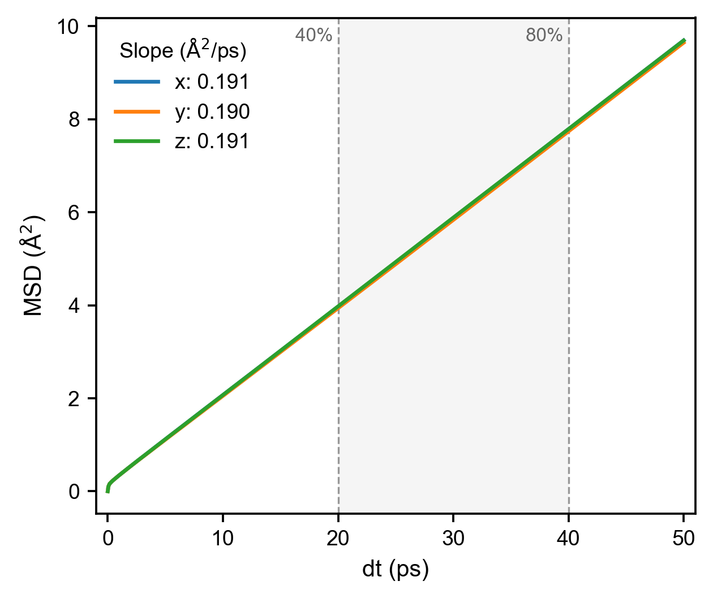
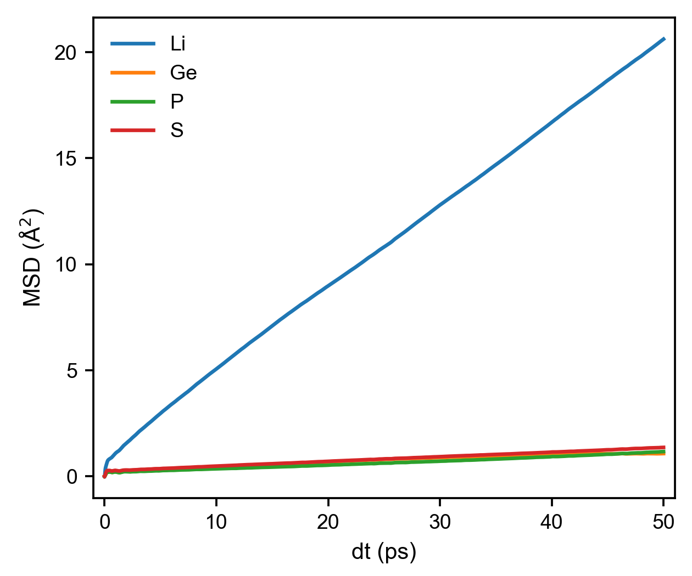
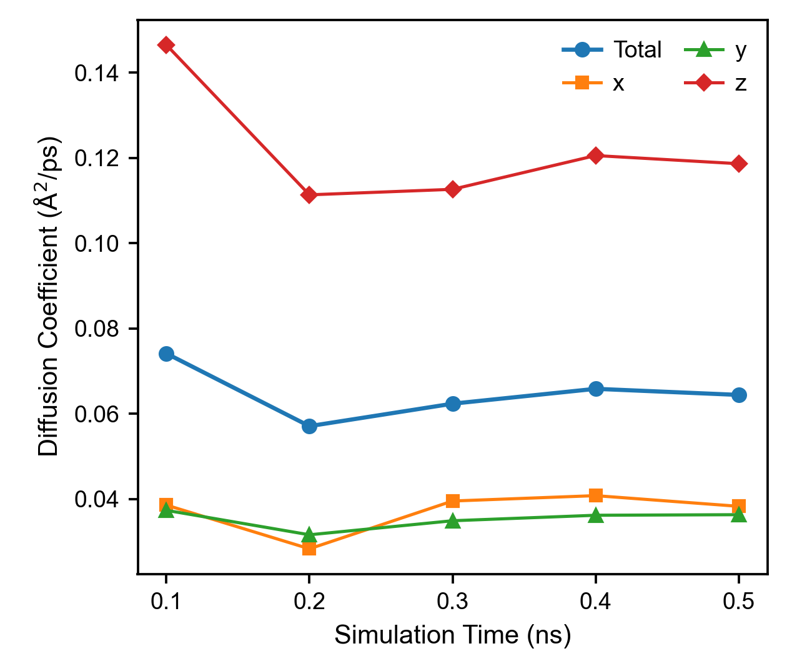
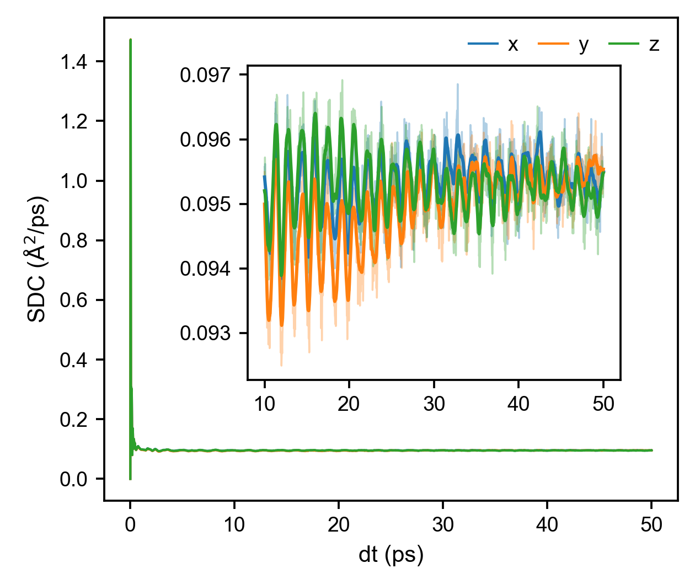
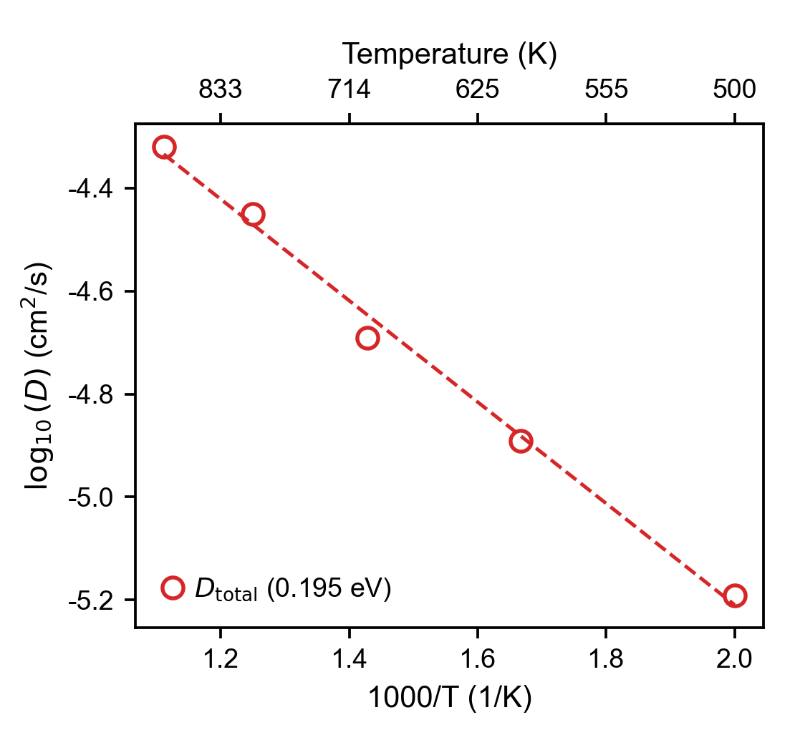
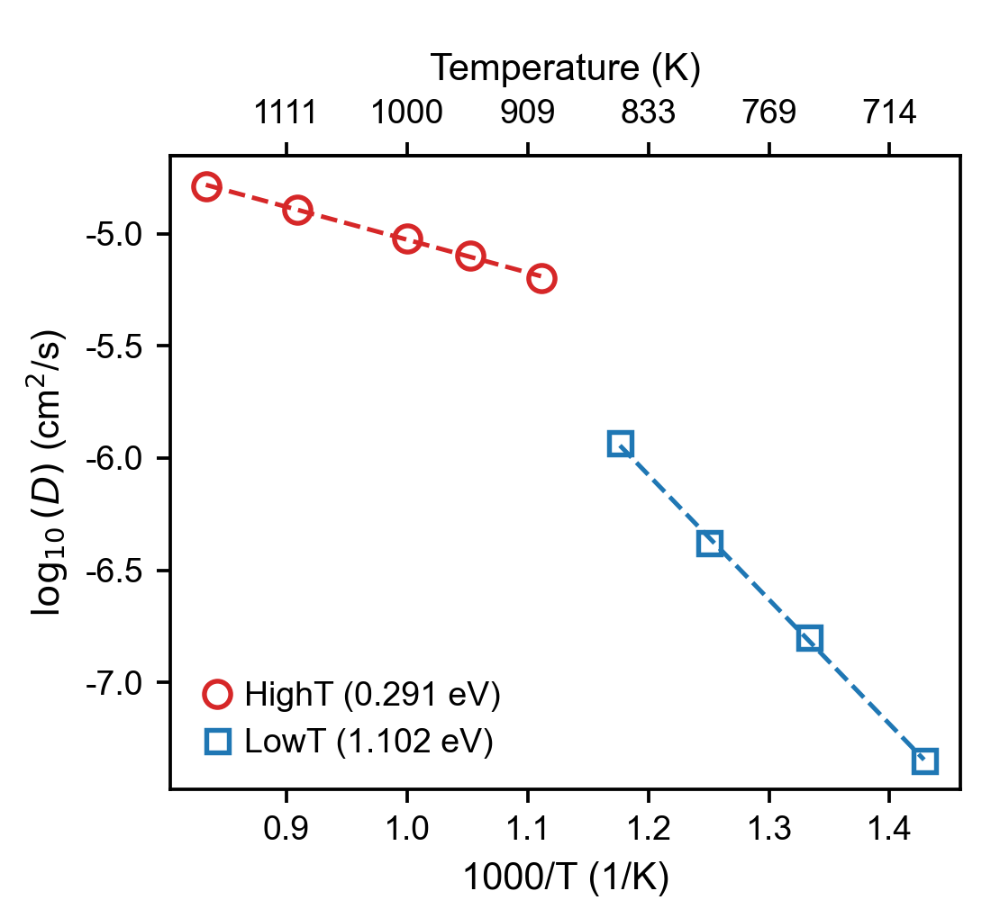
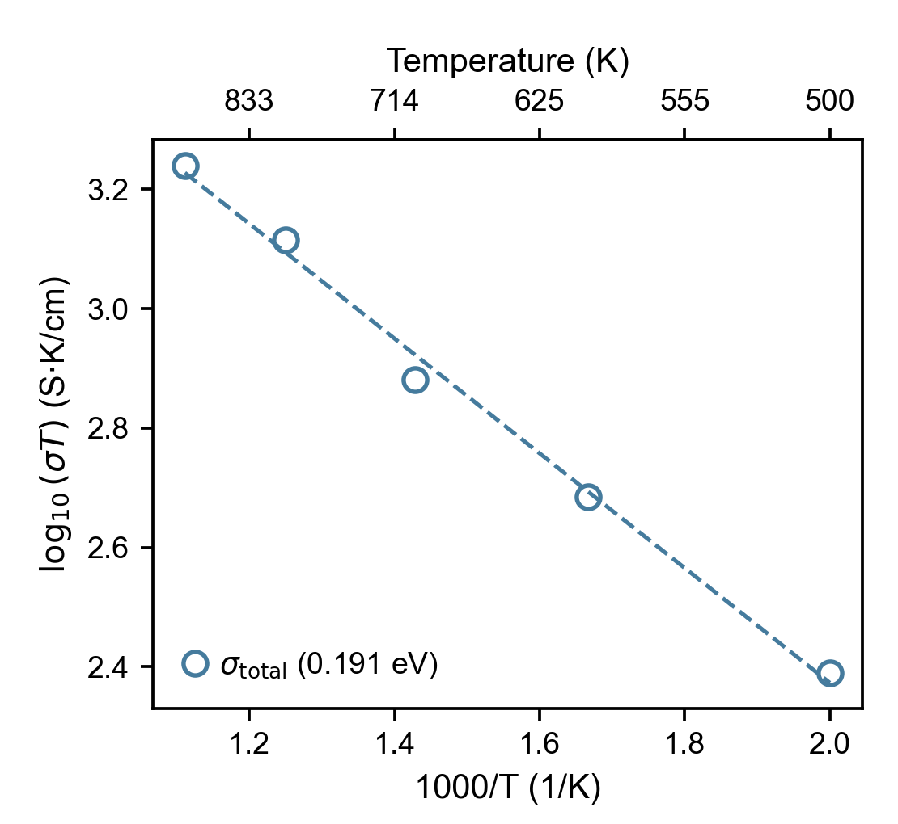
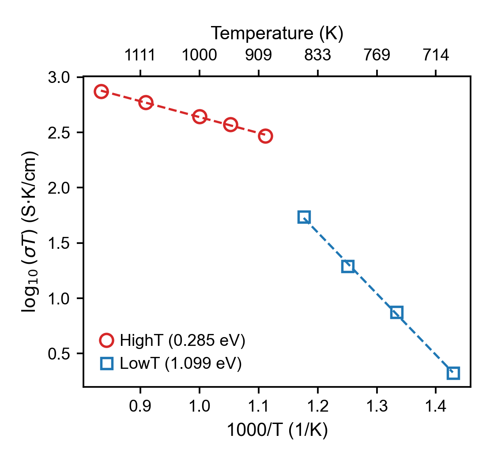

<div align="center">
  <h1>🚶 Diffusion and Ionic Transport</h1>
  <p style="text-align: justify;">Plots for MSD, self-diffusion coefficients, and Arrhenius fits of diffusivity and ionic conductivity.</p>
</div>

← Back to the [Plot Scripts overview](plot_scripts.md)

## Diffusion and Ionic Transport

### msd (`plt_msd.py`)

Plots mean square displacement (MSD) for all directions.

**Input File:** `msd.out` with time and `MSD_x/y/z` in its first four columns.
This accepts the four-column output from `gpumdkit.sh -calc msd` and the first
four columns of GPUMD `compute_msd` output.

The slope annotations use the middle 40%-80% of the MSD series.

```bash
gpumdkit.sh -plt msd
```

<div align="center">
  
</div>

---

### msd_all (`plt_msd_all.py`)

Plots MSD for all atomic species separately when using `all_groups` in GPUMD.

**Input File:** `msd.out` (computed with `all_groups` option)

**Requirements:** Must use `all_groups` in the `compute_msd` command in `run.in`.
For multiple groups, GPUMD appends group data; inspect that layout rather than
assuming the file has the seven columns of a single-group result.

```bash
gpumdkit.sh -plt msd_all msd.out Li P S
```

<div align="center">
  
</div>

---

### msd_conv (`plt_msd_convergence_check.py`)

Checks convergence of MSD calculations across different time windows.

**Input File:** `msd_step*.out` (computed with `save_every` option)

**Requirements:** Use `save_every` in the `compute_msd` command.

**Purpose:** Verify MSD has converged sufficiently for accurate diffusion coefficient calculation.

```bash
gpumdkit.sh -plt msd_conv
```

<div align="center">
  
</div>

---

### sdc (`plt_sdc.py`)

Plots self-diffusion coefficient (SDC) vs time.

**Input File:** a single-group seven-column `msd.out` from GPUMD `compute_msd`:
time, `MSD_x/y/z`, and `SDC_x/y/z`. The four-column file from `-calc msd` is
not sufficient for this plot.

```bash
gpumdkit.sh -plt sdc
```

<div align="center">
  
</div>

---

### msd_sdc (`plt_msd_sdc.py`)

Plots MSD and self-diffusion coefficient (SDC) side by side. The slope
annotations use the middle 40%-80% of the MSD series; the inset shows the
last 80% of the SDC data with a moving-average overlay.

**Input File:** a single-group seven-column `msd.out` from GPUMD `compute_msd`:
time, `MSD_x/y/z`, and `SDC_x/y/z`. The four-column file from `-calc msd` is
not sufficient for this plot.

```bash
gpumdkit.sh -plt msd_sdc
```

---

### D (`plt_arrhenius_d.py`)

Creates Arrhenius plot for diffusivity (log10 D vs 1000/T).

**Input Files:** `*K/msd.out` files (each temperature subdirectory should contain an `msd.out`)

```bash
gpumdkit.sh -plt arrhenius_d
gpumdkit.sh -plt D             # Alternative command
```

**Activation-energy output format:**

```text
Activation Energy: <Ea> eV, R2 = <R2>
```

<div align="center">
  
</div>

---

### D_PT (`plt_arrhenius_d_PT.py`)

Creates a piecewise Arrhenius diffusivity plot around a user-specified phase-transition temperature.
The transition-temperature point is included in both the `LowT` (`T <= Tc`) and `HighT` (`T >= Tc`) fits.

**Input Files:** `*K/msd.out` files

```bash
gpumdkit.sh -plt D_PT 380
gpumdkit.sh -plt D_PT 380 save
```

The legend reports the activation energy of each branch as `HighT (xx eV)` and `LowT (xx eV)`.

<div align="center">
  
</div>

---

### D_xyz (`plt_arrhenius_d_xyz.py`)

Calculates diffusion coefficients from `msd.out` in temperature folders for the
x/y/z directions, generates a directional Arrhenius plot, and extracts the
activation energy of each component.

**Input Files:** `*K/msd.out` files

```bash
gpumdkit.sh -plt D_xyz
```

---

!!! note "Assumptions of the conductivity plots (sigma, sigma_PT, sigma_xyz)"
    These conductivity plots use the first temperature's `model.xyz` to count Li and
    Na together, assume unit charge, and apply the same ion count and replication
    across temperatures. Use them for one mobile Li or Na species with matching MSD
    columns; other species, mixed carriers, or changing composition require a
    separate calculation. They fit the 40%–80% MSD interval and extrapolate
    conductivity to 300 K using the Nernst–Einstein relation. Validate the diffusive
    interval and the extrapolation range before interpreting the results.

### sigma (`plt_arrhenius_sigma.py`)

Creates Arrhenius plot for ionic conductivity (log10(σ·T) vs 1000/T).

**Input Files:** `thermo.out` and `msd.out` in each `*K/` directory;
`model.xyz` and optional `run.in` in the first temperature directory

```bash
gpumdkit.sh -plt arrhenius_sigma
gpumdkit.sh -plt sigma         # Alternative command
```

<div align="center">
  
</div>

---

### sigma_PT (`plt_arrhenius_sigma_PT.py`)

Creates a piecewise Arrhenius ionic-conductivity plot around a user-specified phase-transition temperature.
The transition-temperature point is included in both the `LowT` (`T <= Tc`) and `HighT` (`T >= Tc`) fits.
The 300 K conductivity is extrapolated from the branch on the same side of the transition as 300 K.

**Input Files:** `thermo.out` and `msd.out` in each `*K/` directory;
`model.xyz` and optional `run.in` in the first temperature directory

```bash
gpumdkit.sh -plt sigma_PT 380
gpumdkit.sh -plt sigma_PT 380 save
```

The legend reports the activation energy of each branch as `HighT (xx eV)` and `LowT (xx eV)`.

<div align="center">
  
</div>

---

### sigma_xyz (`plt_arrhenius_sigma_xyz.py`)

Calculates the ionic conductivity from MSD and thermo data in temperature
folders for the x/y/z directions, plots the directional Arrhenius relationship,
and extracts the activation energy of each direction using the Nernst-Einstein
relation.

**Input Files:** `thermo.out` and `msd.out` in each `*K/` directory;
`model.xyz` in the first temperature directory

```bash
gpumdkit.sh -plt sigma_xyz
```
