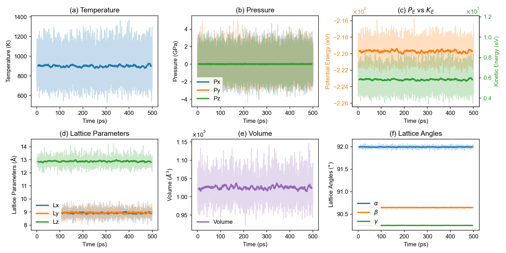
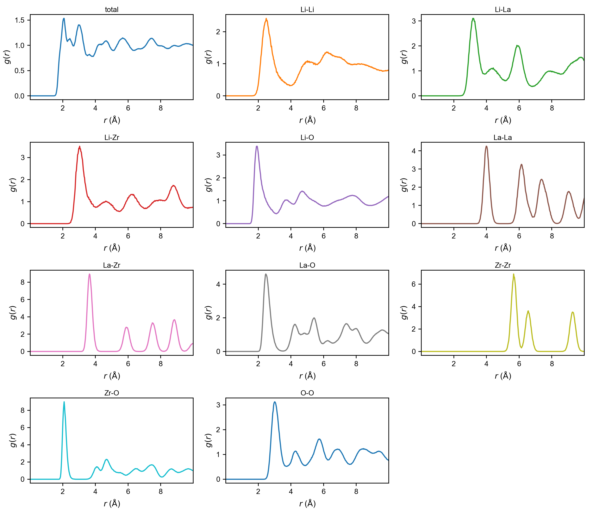
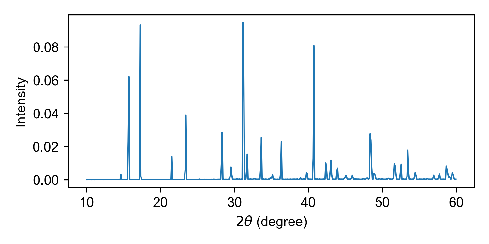
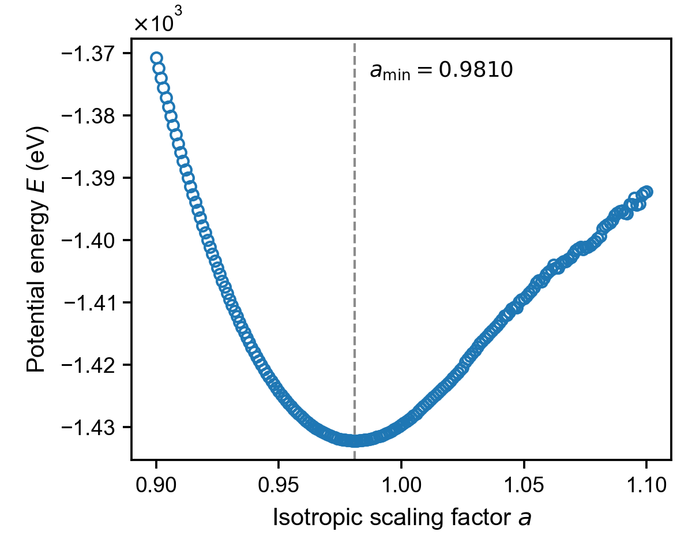
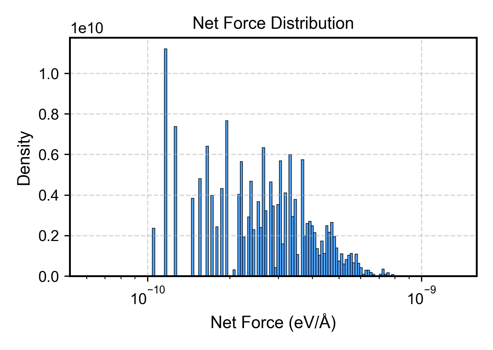

<div align="center">
  <h1>🌡️ MD and Structure</h1>
  <p style="text-align: justify;">Plots for thermodynamic output and structural analysis of MD runs, including polar-material plane profiles.</p>
</div>

← Back to the [Plot Scripts overview](plot_scripts.md)

## Thermodynamic Properties

### thermo (`plt_thermo.py`)

Primary script for comprehensive thermodynamic property visualization.

**Input File:** `thermo.out`

```bash
gpumdkit.sh -plt thermo
```

<div align="center">
  
</div>

---

### thermo2 (`plt_thermo2.py`)

The previous default thermodynamic plot, kept as an alternative style.

**Input File:** `thermo.out`

```bash
gpumdkit.sh -plt thermo2
```

> **Note:** `thermo3` has become the default `thermo` plot. `gpumdkit.sh -plt thermo3` still works for now and prints a reminder, but it will be removed in a future release; use `gpumdkit.sh -plt thermo` instead.


## Structural Analysis

### rdf (`plt_rdf.py`)

Plots all RDF value columns in `rdf.out` (the radius column is used as the x-axis).

**Input File:** `rdf.out`

```bash
gpumdkit.sh -plt rdf               # Plot all RDF pairs
gpumdkit.sh -plt rdf save          # Save the figure as rdf.png
```

The `rdf` plotter does not select a single column. Use `rdf_pmf` when a
specific RDF output column is needed for PMF analysis.

**RDF output:**

<div align="center">
  
</div>

---

### xrd (`plt_xrd.py`)

Plots the X-ray diffraction (XRD) output generated by calculator 413.

**Input File:** `xrd.out` by default; an alternative XRD output path can be
passed as the first argument.

```bash
gpumdkit.sh -plt xrd
gpumdkit.sh -plt xrd path/to/xrd.out save
```

With `save`, the figure is written to `xrd.png` in the current working
directory.

**Example:**

<div align="center">
  
</div>

---

### xrd_comp (`plt_xrd_comp.py`)

Compares XRD curves from several temperature folders in the current working
directory. Each folder must be named `<temperature>K` and contain an
`xrd.out` file written by calculator 413. All curves are drawn in one panel,
shifted along y so that the highest peak never reaches the curve above, with
low temperature at the bottom. Each curve is labelled with its temperature and
colored by a temperature colorbar.

Run the comparison from the directory containing the `*K` subdirectories.
This command does not take a directory argument:

```bash
cd /path/to/xrd_series
gpumdkit.sh -plt xrd_comp
gpumdkit.sh -plt xrd_comp save
```

With `save`, the figure is written to `xrd_comp.png` in the current working
directory.

---

### rdf_pmf (`plt_rdf_pmf.py`)

Plots RDF combined with potential of mean force (PMF).

**Input File:** `rdf.out`

```bash
gpumdkit.sh -plt rdf_pmf
gpumdkit.sh -plt rdf_pmf 300 2 save
```

Both arguments are optional: the temperature in K used to convert the RDF into a PMF, and `column_index`, the `rdf.out` column to use (column 2 is the total RDF; columns 3 and above are pair RDFs).

---

### vac (`plt_vac.py`)

Plots velocity autocorrelation function (VAC). Useful for analyzing phonon properties and atomic dynamics.

**Input File:** `sdc.out` written by GPUMD `compute_sdc` (the VAC columns are
read from this file by the plotting script). This is separate from the
`msd.out` input used by `-plt sdc` and `-plt msd_sdc`.

**Output:** Interactive plot or `vac.png` (with `save` option)

```bash
gpumdkit.sh -plt vac
```

---

### cohesive (`plt_cohesive.py`)

Plots cohesive energy curve from `cohesive.out`. Useful for analyzing lattice stability and equilibrium lattice constants.

**Input File:** `cohesive.out` (isotropic scaling factor vs cohesive energy)

**Output:** Interactive plot or `cohesive.png` (with `save` option)

```bash
gpumdkit.sh -plt cohesive
```

The sampled energy curve is drawn as open circles, and a vertical dashed line
marks the scaling factor at which the energy is lowest. This value, `a_min`,
is read directly from the data, so its precision is the step of the scaling
factor in `compute_cohesive`. The values below come from an LLZO NEP model
scaled isotropically with `compute_cohesive 0.9 1.1 6`.

<div align="center">
  
</div>

---

### net_force (`plt_net_force.py`)

Plots distribution of net forces on structures, useful for identifying problematic configurations.

**Input File:** `train.xyz` (extxyz format)

```bash
gpumdkit.sh -plt net_force train.xyz
```

**Reference:** [arXiv:2510.19774](https://arxiv.org/abs/2510.19774)

<div align="center">
  
</div>


## Plane-Grid Plot for Polar Materials

This workflow maps displacement or polarization data onto a grid and plots selected plane profiles. For detailed usage and real-world examples, see **[Polar Material Analysis](polar_material_analysis.md)**.

**Dependency:**

```bash
pip3 install git+https://github.com/MoseyQAQ/ferrodispcalc.git
```

**Typical upstream steps:**

```bash
gpumdkit.sh -calc nlist -i model.xyz -c 4 -n 12 -C Pb Sr -E O
gpumdkit.sh -calc disp -i movie.xyz -n nl-Pb_Sr-O.dat -o displacements.dat
gpumdkit.sh -calc avg-struct -i movie.xyz -l 0.2 -o averaged_structure.xyz
```

**Usage:**

```bash
gpumdkit.sh -plt plane-grid -i averaged_structure.xyz -d displacements.dat -e Pb Sr
gpumdkit.sh -plt plane-grid -i averaged_structure.xyz -d displacements.dat -e Pb Sr --select-xy 0 1
```
