<div align="center">
  <h1>🧠 NEP 训练与模型分析</h1>
  <p style="text-align: justify;">NEP 训练和预测结果、电荷、描述符、dimer 曲线以及原子能量的绘图。</p>
</div>

← 返回[绘图脚本总览](绘图脚本.md)

## NEP 训练与预测

`train`、`prediction`、`train_density` 和 `parity_density` 绘图还会在终端
输出能量、力和应力的 R^2、MAE 与 RMSE 表格。若没有有效的应力数据，
应力项显示为 `N/A`。

### train (`plt_train.py`)

可视化 NEP 训练过程，包括 loss 曲线、RMSE 演化，以及能量/力/应力的 DFT vs NEP parity 图。

**输入文件：** `loss.out`、`energy_train.out`、`force_train.out`，以及优先读取的
`stress_train.out` 或回退使用的 `virial_train.out`

```bash
gpumdkit.sh -plt train
```

<div align="center">
  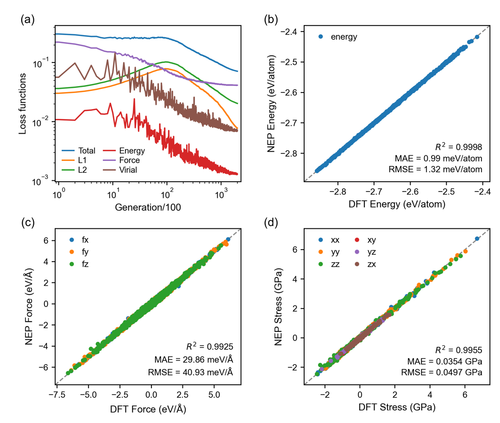
</div>

---

### prediction (`plt_prediction.py`)

可视化 prediction 模式对 `train.xyz` 中结构生成的 NEP 预测结果。
prediction 模式的 parity 数据仍写入以 `_train.out` 结尾的文件。

**输入文件：** `energy_train.out`、`force_train.out`，以及优先读取的
包含有效行的 `stress_train.out`，或回退使用的 `virial_train.out`

```bash
gpumdkit.sh -plt prediction
gpumdkit.sh -plt test         # 替代命令
```

<div align="center">
  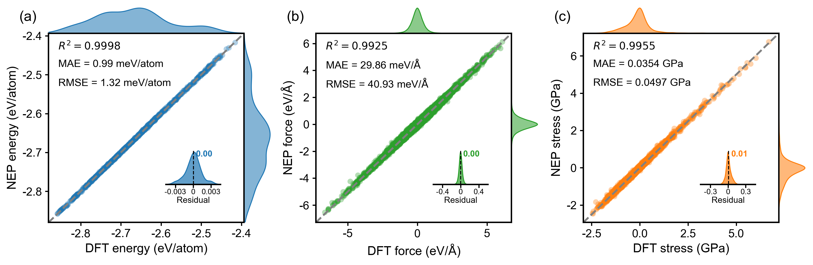
</div>

---

### train_test (`plt_train_test.py`)

将训练集和测试集的 parity plot 合并显示。

**输入文件：** `energy_train.out`、`force_train.out`、`stress_train.out`、
`energy_test.out`、`force_test.out` 和 `stress_test.out`

```bash
gpumdkit.sh -plt train_test
```

<div align="center">
  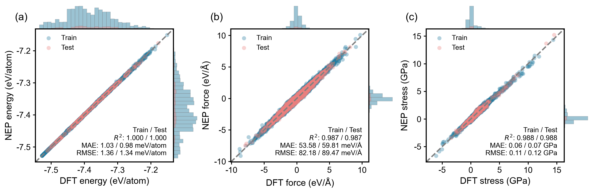
</div>

---

### parity_density (`plt_parity_density.py`)

生成基于密度的 parity plot，适用于大数据集（散点图过于密集时更易阅读）。

**输入文件：** `energy_train.out`、`force_train.out`，以及优先读取的
`stress_train.out` 或回退使用的 `virial_train.out`

```bash
gpumdkit.sh -plt parity_density
```

<div align="center">
  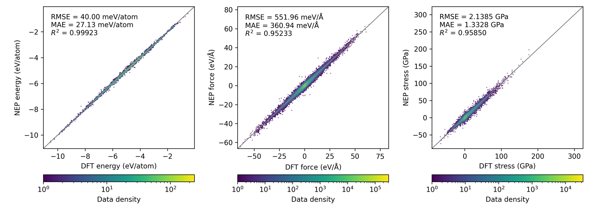
</div>

---

### train_density (`plt_train_density.py`)

生成基于密度的 NEP 训练 parity 图（能量、力、应力或 virial）。同时存在两种
张量输出时优先使用应力。适用于散点图过密的大数据集。

**输入文件：** `energy_train.out`、`force_train.out`，以及优先读取的
`stress_train.out` 或回退使用的 `virial_train.out`

```bash
gpumdkit.sh -plt train_density
```

---

### force_errors (`plt_force_errors.py`)

参考 [Liu et al.](https://doi.org/10.1038/s41524-023-01123-3) 的方法绘制力误差评估指标。

**输入文件：** `force_train.out`

**显示指标：**
- 力大小误差 (delta_F)
- 力角度误差 (delta_theta)
- 误差分布

```bash
gpumdkit.sh -plt force_errors
```

<div align="center">
  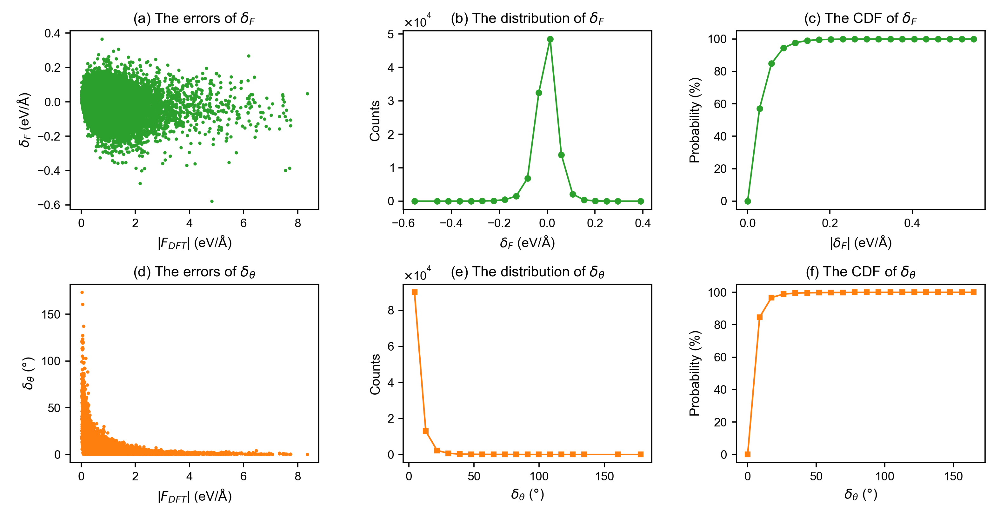
</div>

---

### restart (`plt_nep_restart.py`)

可视化 `nep.restart` 文件中存储的参数。

**输入文件：** `nep.restart`

```bash
gpumdkit.sh -plt restart
```

<div align="center">
  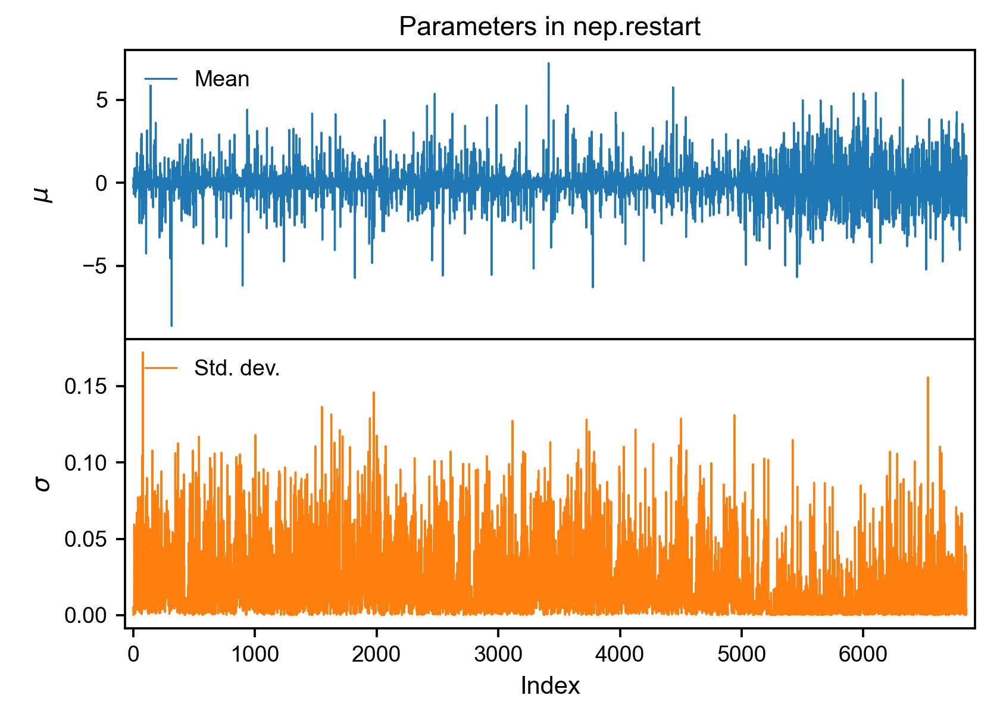
</div>

---

### charge (`plt_charge.py`)

绘制 `qNEP` 模型的电荷分布。

**输入文件：** `train.xyz` 和 `charge_train.out`

**重要提示：** 确保训练集和电荷输出的原子排序一致。建议使用全 batch 训练或先运行预测步骤。

```bash
gpumdkit.sh -plt charge
```

<div align="center">
  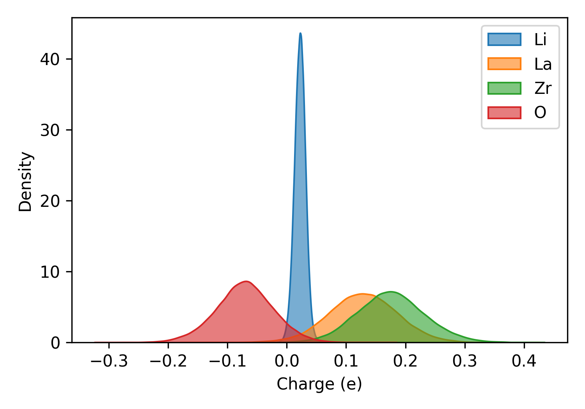
</div>

---

### born_charge (`plt_born_charge.py`)

为训练集和测试集创建 Born 有效电荷 (BEC) 的 parity plot。全零参考 BEC 的结构会被过滤。

**输入文件：** `bec_train.out`；可选 `bec_test.out`

```bash
gpumdkit.sh -plt born_charge
gpumdkit.sh -plt bec          # 替代命令
```

<div align="center">
  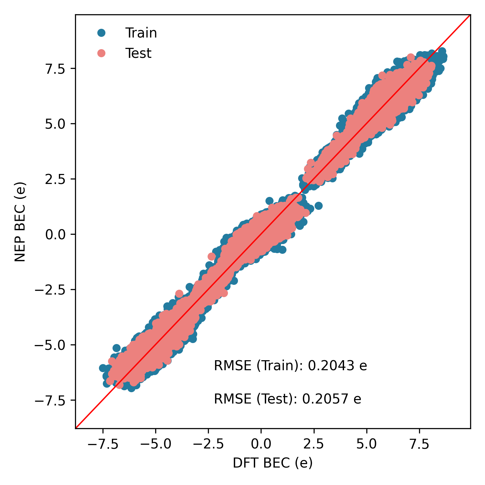
</div>


## 描述符、Dimer 和其他分析

### des (`plt_descriptors.py`)

使用降维方法（PCA 或 UMAP）可视化高维 NEP 描述符。

**输入文件：** `descriptors.npy`（由 `gpumdkit.sh -calc des` 生成）

**方法：**
- `pca` — 主成分分析
- `umap` — 统一流形逼近与投影

```bash
# 先计算描述符
gpumdkit.sh -calc des train.xyz descriptors.npy nep.txt Li

# 再可视化
gpumdkit.sh -plt des pca descriptors.npy
gpumdkit.sh -plt des umap descriptors.npy
```

<div align="center">
  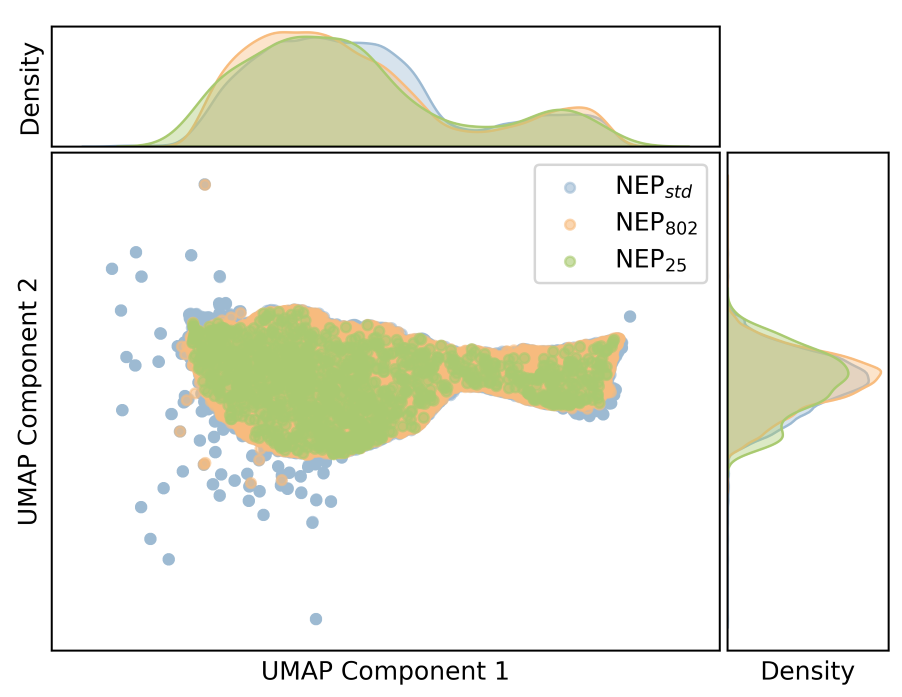
</div>

---

### dimer (`plt_dimer.py`)

绘制二聚体相互作用曲线。将两个原子放入立方盒子（30 Å），使用 NEP 模型计算势能和力随距离的变化。

**输入文件：** `nep.txt`

```bash
gpumdkit.sh -plt dimer <element1> <element2> <nep.txt> [save]
gpumdkit.sh -plt dimer Li Li nep.txt
```

<div align="center">
  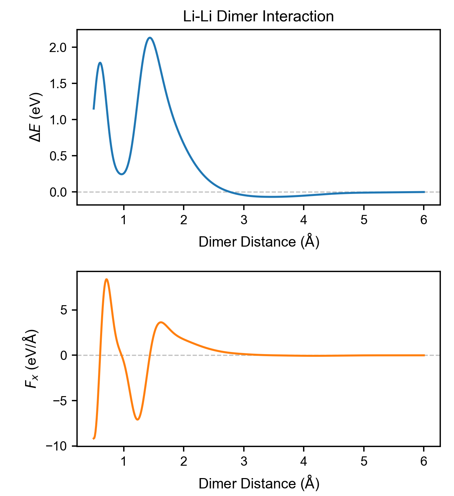
  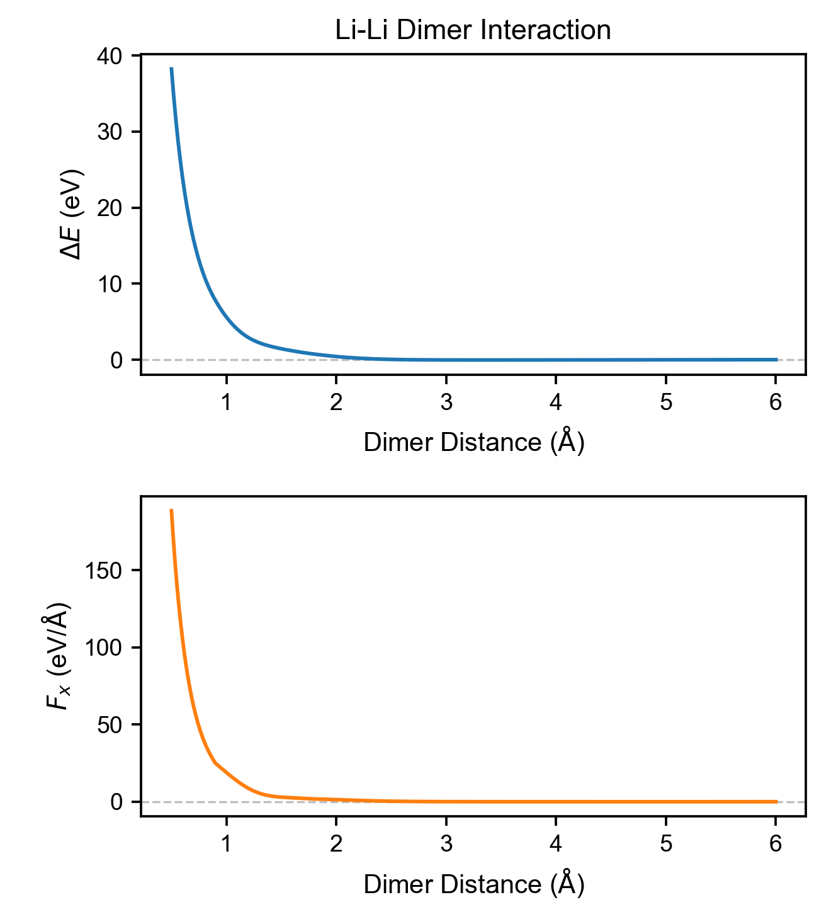
</div>

**参考文献：** [J. Chem. Inf. Model. 2026, 66, 3, 1406-1413](https://doi.org/10.1021/acs.jcim.5c02335)

---

### doas (`plt_doas.py`)

绘制 [Wang et al.](https://doi.org/10.1002/anie.202215544) 提出的原子态密度 (DOAS)。

**输入文件：** `doas.out`（由 `gpumdkit.sh -calc doas` 计算）

```bash
gpumdkit.sh -plt doas <doas.out> <species>
gpumdkit.sh -plt doas doas.out Li
```

<div align="center">
  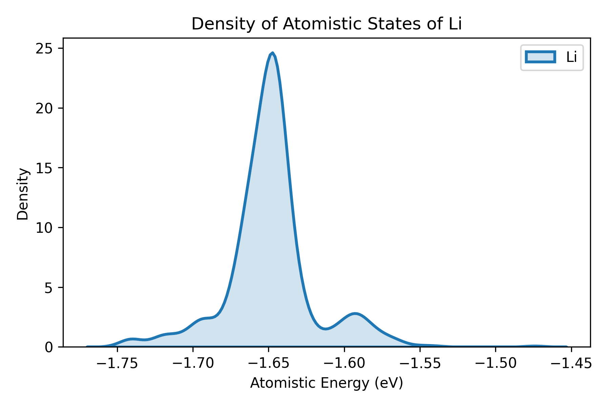
</div>
