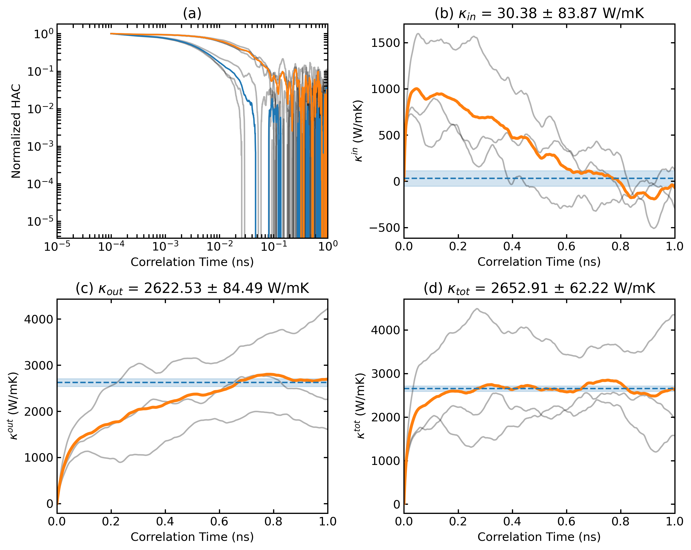
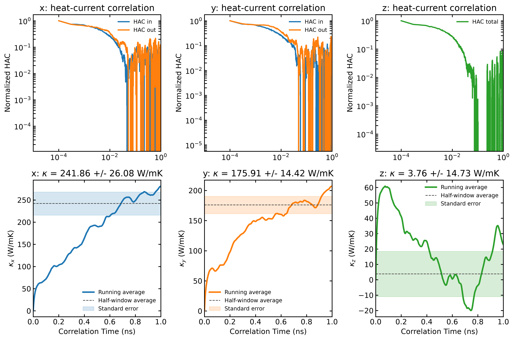
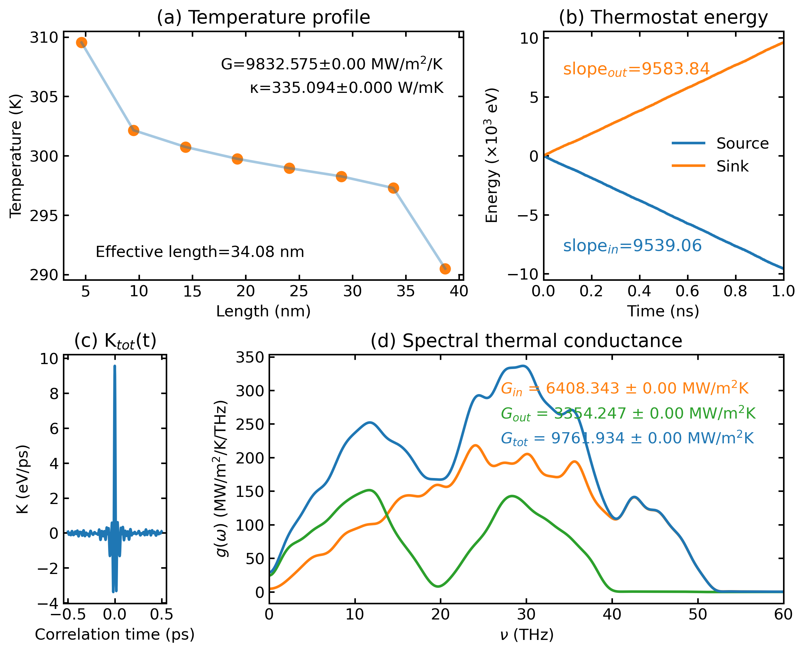
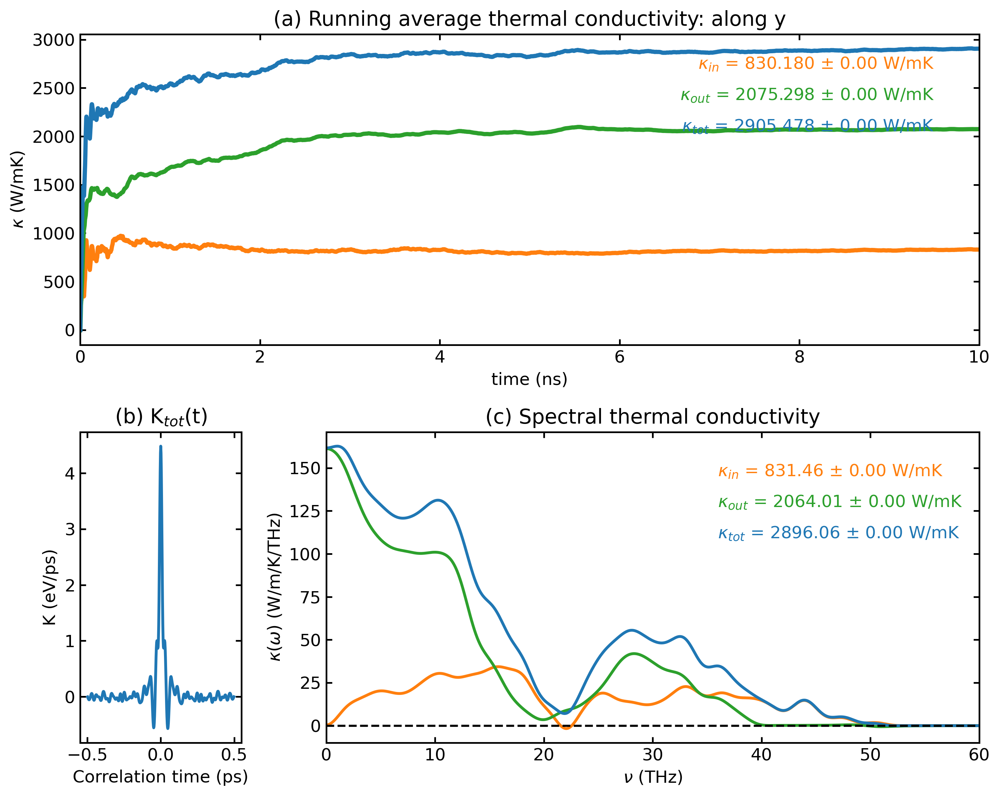
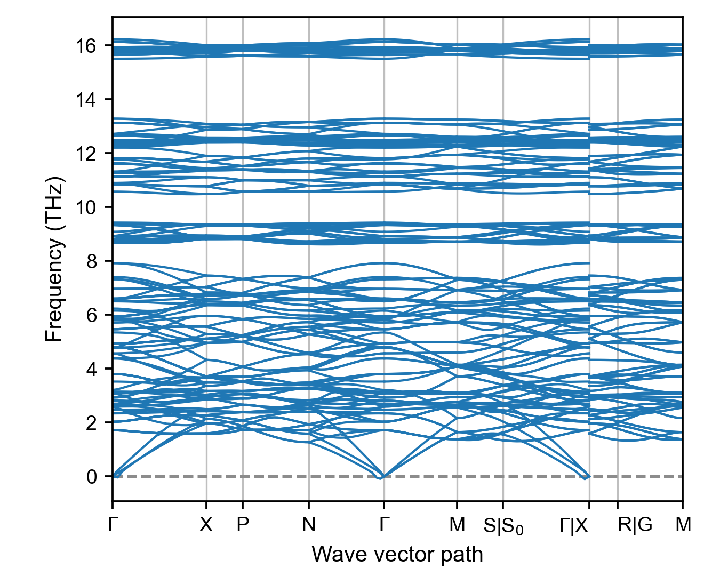
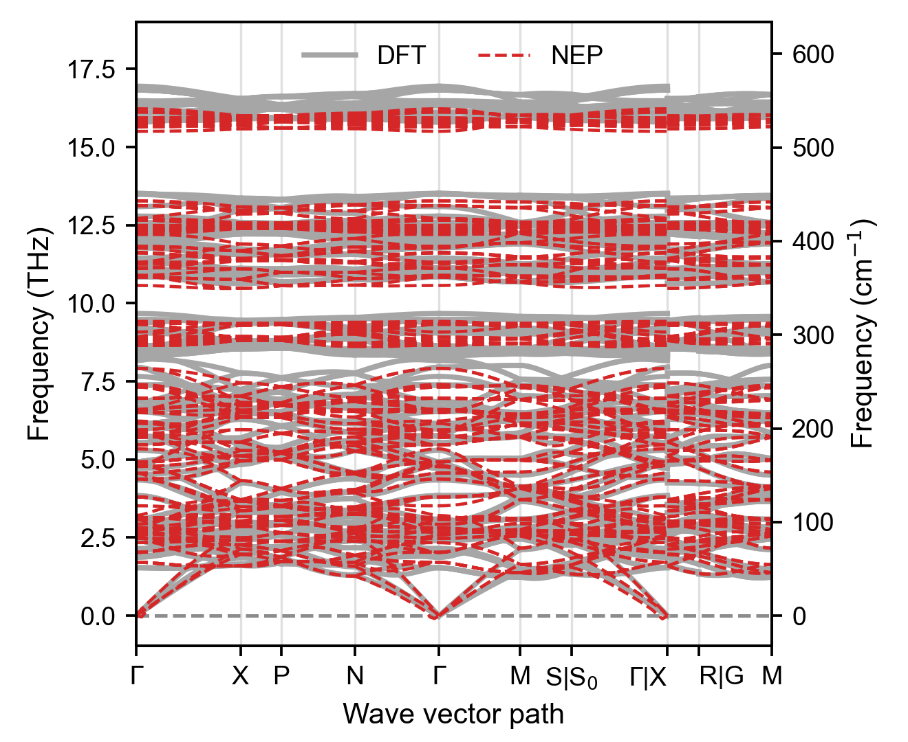
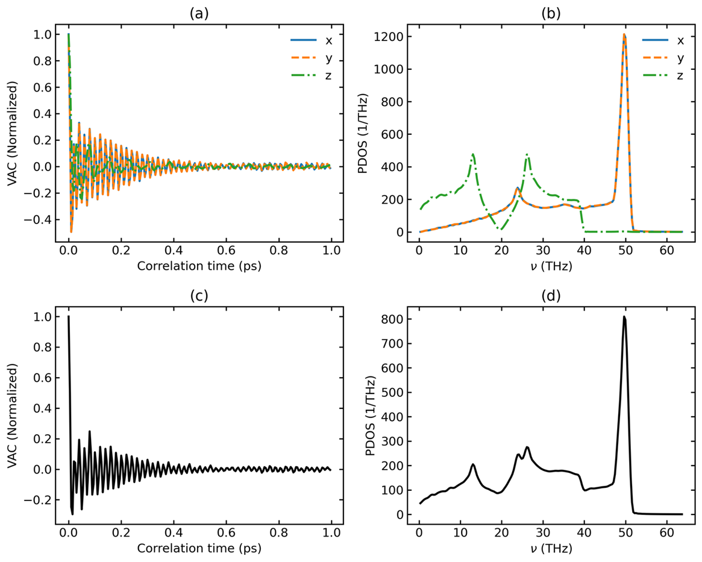
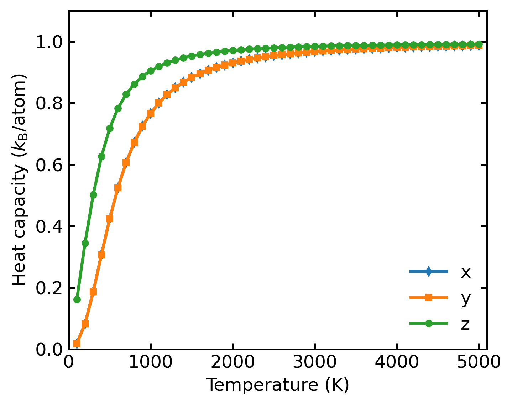

<div align="center">
  <h1>🔥 热输运与声子</h1>
  <p style="text-align: justify;">EMD、NEMD、HNEMD 热输运、黏度、声子色散和 PDOS 的绘图。</p>
</div>

← 返回[绘图脚本总览](绘图脚本.md)

## 热输运

保存选项为 `--save`（图片）和 `--save-data`（处理后的数据）；旧写法 `save` 和 `save_data` 仍然可用。

### emd (`plt_emd.py`)

分析并绘制平衡分子动力学 (EMD) 热导率。

**输入文件：** GPUMD 的 EMD 输出文件

```bash
gpumdkit.sh -plt emd x --save-data        # 导出处理后的数据
gpumdkit.sh -plt emd x --save --save-data # 同时保存图片和数据
```

`--save` 将图片保存为 `emd.png`；`--save-data` 将处理后的数组保存为
`data_emd.npz` 和制表符分隔的 `data_emd.txt`，两个选项相互独立。

<div align="center">
  
</div>

---

### emd2 (`plt_emd2.py`)

在同一幅图中绘制 x、y、z 三个方向的热流关联函数和 EMD 总热导率。该功能使用与
`plt_emd.py` 相同的 `run.in`、`hac.out` 和平均规则。

**输入文件：** GPUMD 的 EMD 输出文件

```bash
gpumdkit.sh -plt emd2             # 显示全部方向结果
gpumdkit.sh -plt emd2 save        # 保存为 emd2.png
```

HAC 图使用对数相关时间轴，同时在纵轴保留 HAC 的正负号。物理上为零的
方向会显示为零曲线。输出的不确定度沿用旧版规则，即后半段窗口波动除以
HAC 重复次数的平方根；它不是独立轨迹之间的标准误差。

<div align="center">
  
</div>

---

### nemd (`plt_nemd.py`)

可视化非平衡分子动力学 (NEMD) 热输运性质。

**输入文件：** GPUMD 的 NEMD 输出文件

**参数说明：**

| 参数 | 说明 |
|------|------|
| `real_length` | 传热区实际长度（nm），设为 `Auto` 可自动计算 |
| `scale_eff_size` | 有效截面积缩放因子（默认：1）。三维体相用 1；含真空层的低维体系用 S_box / S_eff |
| `cutoff_freq` | SHC 计算的截止频率（THz，默认：60） |
| `--save` | 可选，保存图片为 `nemd.png` |
| `--save-data` | 可选，额外导出制表符分隔的 `data_nemd.txt`；存在 SHC 数据时还导出 `data_shc.txt` |

```bash
gpumdkit.sh -plt nemd [real_length] [scale_eff_size] [cutoff_freq] [--save] [--save-data]
gpumdkit.sh -plt nemd --save-data                         # 使用默认参数并导出数据
gpumdkit.sh -plt nemd Auto 1 60 --save --save-data       # 同时保存图片和数据
```

`data_nemd.npz`（以及存在 SHC 数据时的 `data_shc.npz`）总会写出。

<div align="center">
  
</div>

---

### hnemd (`plt_hnemd.py`)

绘制均匀非平衡分子动力学 (HNEMD) 结果。

**输入文件：** GPUMD 的 HNEMD 输出文件

**参数说明：**

| 参数 | 说明 |
|------|------|
| `scale_eff_size` | 有效截面积缩放因子（默认：1） |
| `cutoff_freq` | SHC 计算的截止频率（THz，默认：60） |
| `--save` | 可选，保存图片为 `hnemd.png` |
| `--save-data` | 可选，将处理后的数组保存为 `data_hnemd.npz` 和制表符分隔的 `data_hnemd.txt`；存在 SHC 数据时还保存 `data_shc.npz` 和 `data_shc.txt` |

```bash
gpumdkit.sh -plt hnemd [scale_eff_size] [cutoff_freq] [--save] [--save-data]
gpumdkit.sh -plt hnemd --save-data             # 使用默认参数并导出数据
gpumdkit.sh -plt hnemd 1 60 --save --save-data # 同时保存图片和数据
```

<div align="center">
  
</div>

---

### viscosity (`plt_viscosity.py`)

绘制 `viscosity.out` 中的应力自相关和粘度分量，包括对角和非对角分量。

**输入文件：** GPUMD 粘度计算生成的 `viscosity.out`

```bash
gpumdkit.sh -plt viscosity
```


## 声子

### phonon (`plt_phonon.py`)

绘制由计算器 `414` 生成的声子谱。绘图脚本会直接读取 line-mode 格式的
`QPOINTS` 文件中的 Q 点路径和高对称点标签，因此不需要在脚本中重复写死
路径。

**输入文件：** 声子数据文件（默认 `phonon_NEP.dat`）和 `QPOINTS`

计算步骤使用交互模式：

```text
gpumdkit.sh -> 4) Calculators -> 414) Calc phonon band structure
```

Python 页面会依次询问原胞结构（默认 `PRIMCELL.vasp`）、NEP 模型（默认
`nep.txt`）、路径文件（默认 `QPOINTS`）、超胞、位移幅度和输出文件名
（默认 `phonon_NEP.dat`）。该功能除了 GPUMDkit/Calorine 的常规依赖外，还
需要安装 `phonopy`。

绘图命令：

```bash
gpumdkit.sh -plt phonon
gpumdkit.sh -plt phonon phonon_DFT.dat
gpumdkit.sh -plt phonon phonon_NEP.dat QPOINTS save
```

声子数据文件可以省略；省略时绘图脚本读取 `phonon_NEP.dat`。如果只提供一个
数据文件，路径文件默认使用 `QPOINTS`。

<div align="center">
  
</div>

---

### phonon_comp (`plt_phonon_comp.py`)

比较两个或多个声子谱文件。图例会从文件名自动读取：`phonon_NEP.dat` 显示
为 `NEP`，`phonon_DFT.dat` 显示为 `DFT`，`phonon_MACE.dat` 显示为 `MACE`。

```bash
gpumdkit.sh -plt phonon_comp phonon_DFT.dat phonon_NEP.dat save
gpumdkit.sh -plt phonon_comp phonon_DFT.dat phonon_NEP.dat phonon_MACE.dat \
    --qpoints QPOINTS save
```

默认读取 `QPOINTS` 作为路径文件，其他文件名可用 `--qpoints FILE` 指定。所有文件必须使用相同的 q 点采样和相同的声子支数。

<div align="center">
  
</div>

---

### pdos (`plt_pdos.py`)

计算并绘制归一化的速度自相关函数 (VAC)、声子态密度 (PDOS) 和热容 (Cv)。

**输入文件：** `model.xyz`、`run.in`、`dos.out`、`mvac.out`

```bash
gpumdkit.sh -plt pdos
gpumdkit.sh -plt pdos save
```

<div align="center">
  
</div>

热容输出：

<div align="center">
  
</div>
