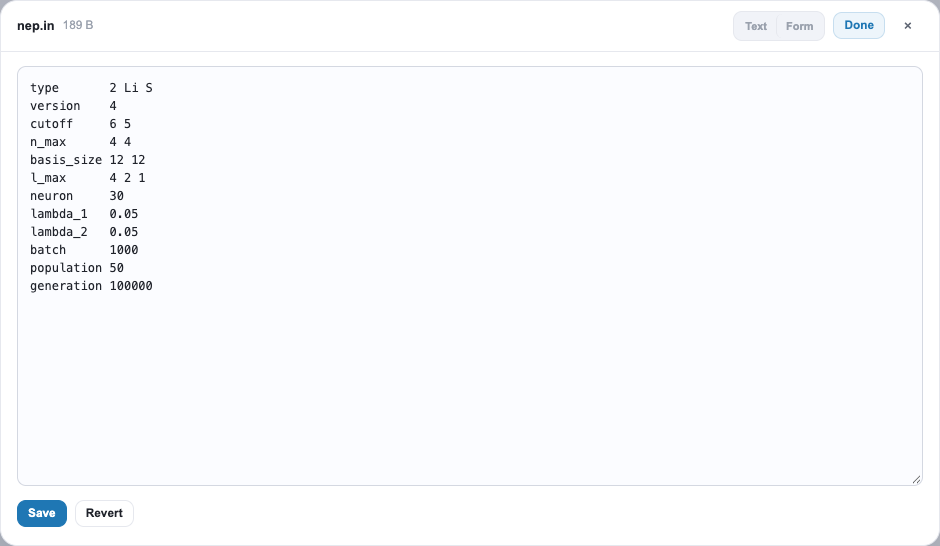
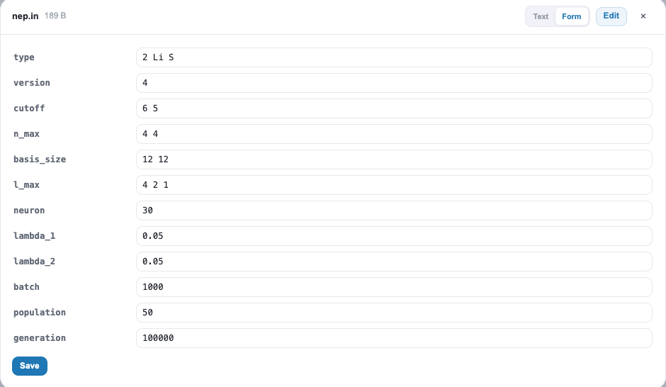
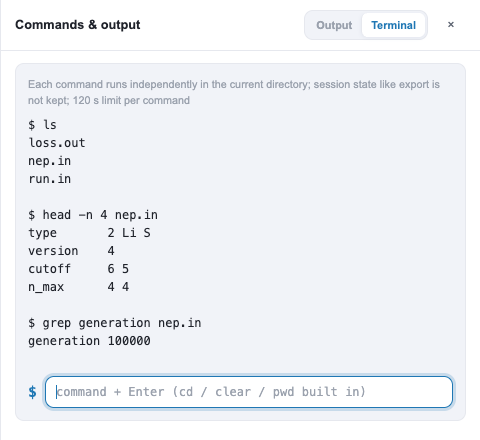

<div align="center">
  <h1>远程网页控制台</h1>
  <p style="text-align: justify;">通过 SSH 隧道，在本地浏览器中浏览模拟与训练目录、一键出图、跟踪 NEP 与 MD 进度，并安全地修改小型输入文件。</p>
</div>

## 功能简介

`gpumdkit.sh -server` 会以启动时所在目录为根目录，开启一个基于浏览器的控制台。浏览器显示的文件**始终留在远程主机上**，除非你主动下载，否则不会复制到本地工作站。适合以下场景：

- 不用登录后手动查看 `loss.out`，就能知道 NEP 训练或 MD 运行是否正常；
- 一键绘制常用图（训练、MSD、thermo、Arrhenius）并立即查看；
- 修改 `nep.in` 或 `run.in` 中的某个关键字并安全保存；
- 在远程主机上快速执行一条 shell 命令。

它**不是**作业启动器：控制台不会启动 GPUMD 或 NEP，不会提交调度器作业，也无法判断进程是否仍在运行。它读取的是你的计算写出的输出文件。

## 在远程主机上启动服务

先通过 SSH 登录，激活包含 GPUMDkit 及其绘图依赖的环境，进入希望暴露的目录，然后启动服务：

```bash
ssh <用户名>@<主机名>
conda activate gpumdkit
cd /path/to/working-directory
gpumdkit.sh -server
```

请保持此终端打开。服务默认监听远程主机上的 `127.0.0.1:8888`。启动目录就是文件浏览器的根目录；界面可以进入其子目录，但文件接口无法浏览其上级目录。

## 从本地工作站连接

在**你自己的电脑**上再打开一个终端，建立隧道：

```bash
ssh -N -L 8888:127.0.0.1:8888 <用户名>@<主机名>
```

保持它运行，然后在本地浏览器中打开：

```text
http://127.0.0.1:8888
```

```text
  local workstation                               remote host
┌─────────────────────────┐   SSH tunnel (encrypted)  ┌──────────────────────────────┐
│ browser                 │ ◄───────────────────────► │ gpumdkit.sh -server          │
│ http://127.0.0.1:8888   │  ssh -N -L 8888:...:8888  │ 127.0.0.1:8888 (files here)  │
└─────────────────────────┘                           └──────────────────────────────┘
```

第一个 `8888` 是**本地**端口，最后一个是**远程**服务端口。端口被占用时：

| 被占用的端口 | 处理方式 |
|---|---|
| 本地 | 换一个本地端口：`ssh -N -L 8890:127.0.0.1:8888 <用户名>@<主机名>`，然后访问 `http://127.0.0.1:8890`。 |
| 远程 | 用其他端口启动服务 `gpumdkit.sh -server 9000`，再转发：`ssh -N -L 8888:127.0.0.1:9000 <用户名>@<主机名>`。 |

在本地终端按 `Ctrl+C` 关闭隧道，在远程终端按 `Ctrl+C` 停止服务。

## 界面导览

每个目录对应一个内容区。**只有存在相应数据时才会出现相应区块**：没有 `loss.out` 的目录不会显示损失曲线，没有图片的目录不会显示图片条。把鼠标移到下面的编号（或右侧条目）上可高亮对应区域，点击图片可放大。

### NEP 训练目录

<!-- annotated-shot: training -->

### GPUMD 运行目录

<!-- annotated-shot: md -->

截图来自示例运行，你的目录会显示你自己的数据。

## 哪些文件会触发哪些内容

| 目录中的文件 | 控制台显示什么 |
|---|---|
| `loss.out` | 损失曲线。若同时有 `nep.in`，还会显示进度条（当前代数与 `generation` 目标的对比）和参数面板。 |
| `neighbor.out` 与 `run.in` | MD 监控：近邻数与其最大值的对比，以及相对 `run.in` 中 `run` 步数的进度。 |
| `thermo.out`（没有 `neighbor.out`） | 由行数和 `dump_thermo` 估算的近似 MD 进度，规则与 `gpumdkit.sh -time gpumd` 相同。 |
| `.png` / `.jpg` 图片 | 缩略图条；点击可进入大图查看（`←` `→` 切换，`Esc` 关闭）。 |
| 绘图所需的文件（见下） | 对应的**操作**卡片。 |
| 子目录 | 带条目数的列表，方便进入 `300K/`、`400K/` 等目录。 |

## 绘图操作

**操作**中的每张卡片都会在当前目录运行一个固定的 GPUMDkit 绘图脚本。卡片会告诉你图是否已生成及生成时间；**Run** 生成（或重新生成），**View** 打开结果。如果图片比其输入文件更旧，会被标记为已过期。**Run all** 运行所有卡片。

| 操作 | 目录中所需文件 | 生成 |
|---|---|---|
| MSD | `msd.out` | `msd.png` |
| SDC | `msd.out` | `sdc.png` |
| MSD & SDC | 七列的 `msd.out` | `msd_sdc.png` |
| MSD 收敛性 | `msd_step*.out` | `msd_convergence.png` |
| VAC | `sdc.out` | `vac.png` |
| Thermo | `thermo.out` | `thermo.png` |
| 训练 | `loss.out`、`energy_train.out`、`force_train.out` | `train.png` |
| 训练密度图 | 与“训练”相同 | `train_density.png` |
| 训练与测试 | 六个训练/测试的能量、力、应力 `.out` 文件 | `train_test.png` |
| 预测 | `energy_train.out`、`force_train.out` | `prediction.png` |
| Arrhenius 电导率 | 至少两个 `NNNK` 目录，每个含 `msd.out` 和 `thermo.out` | `Arrhenius_sigma.png` |
| Arrhenius 扩散系数 | 至少两个 `NNNK` 目录，每个含 `msd.out` | `Arrhenius_D.png` |

需要额外参数的绘图（例如带元素列表的 `-plt msd_all`）不会显示为卡片，请在命令抽屉的终端中运行。

### 示例：由多个温度绘制 Arrhenius 图

每个温度一个目录，命名为 `300K`、`400K`、`500K` 等，每个目录放该次运行的 `msd.out`（电导率还需要 `thermo.out`）：

```text
diffusion/
├── 300K/   msd.out  thermo.out
├── 400K/   msd.out  thermo.out
├── 500K/   msd.out  thermo.out
└── 600K/   msd.out  thermo.out
```

在 `diffusion/` 中启动服务（或在文件浏览器中进入该目录）。存在至少两个温度目录时会出现 **Arrhenius** 卡片，点击 **Run**，再点击 **View**。图片会写在数据旁边（`Arrhenius_D.png`、`Arrhenius_sigma.png`）。拟合是否有意义，例如各温度的 MSD 是否收敛，需要你自己判断：请先在每个温度目录里用 MSD 与 MSD 收敛性卡片检查。

## 跟踪 NEP 训练

打开训练目录（包含 `nep.in` 和 `loss.out` 的目录）。

- **损失曲线。** 两个坐标轴默认为对数刻度；**X Log**、**Y Log** 按钮可将对应坐标轴切换为线性。点击图例条目可隐藏或显示某一项损失，悬停可读取采样值，缩放按钮可放大查看。当代数重新从头计数（续跑）时，横轴会变为记录序号。
- **进度。** 目标取自 `nep.in` 中的 `generation`；如果 `nep.in` 没有该行，则假定 NEP 默认的 100000，卡片上会注明。控制台至少看到两次 `loss.out` 采样后才会显示速度和 ETA。
- **参数。** 右侧面板列出 `nep.in` 的关键字；**open file** 可查看完整文件。

可在顶栏设置**自动刷新**（5 s 到 60 s）以保持视图最新。默认关闭，浏览器标签页隐藏时会暂停。进度条增长说明 `loss.out` 正在写入新记录，但并不能证明进程仍然存活。

## 跟踪 MD 运行

在含有 `neighbor.out` 的目录中，监控会绘制径向和角向近邻数以及 `neighbor.out` 报告的最大值。虚线最大值仅作参考，不是稳定性判据。进度是 MD 步数与 `run.in` 中各 `run` 命令步数之和的对比；ETA 需要两次采样。

## 安全地编辑文件

点击文件名打开预览面板。512 KB 以内的文本文件完整显示；更大的文件只显示头部和尾部，且不能编辑。数值文件显示为表格，并可选择绘图。

<div class="img-pair">
  
  
</div>

点击 **Edit** 使文件可编辑。对于 `nep.in`、`run.in` 等关键字文件，可以在**文本**与**表单**视图之间切换，两者编辑的是同一份草稿。**Save** 以原子方式写入文件。

如果文件在你打开之后发生了变化，例如被其他进程重写，保存会被拒绝，你可以选择 **Reload**、**Keep my draft** 或 **Overwrite**。在有未保存修改时切换到其他文件，会先询问确认。

**New** 创建空文件或文件夹，**Upload** 从工作站上传文件，**Download** 下载选中的远程文件。创建和上传都不会覆盖已有的同名项。

> 编辑 `nep.in` 不会重启任何程序。请自行在终端或调度系统中启动或重启 `nep` 与 GPUMD，再让控制台显示新的输出。

## 命令抽屉

顶栏的终端图标会打开 **Commands & output** 抽屉。

- **Output** 列出 Run 按钮执行过的操作：命令、运行目录、耗时、状态和输出。
- **Terminal** 在远程主机上执行 shell 命令。

<div align="center">
  
</div>

每条命令独立使用 `bash -c` 在当前目录运行，超过 120 s 会被终止。`export` 等状态不会在命令之间保留，`cd`、`pwd`、`clear` 为内置命令。没有取消按钮。由于终端执行的是真实命令，它**不受**文件浏览器所显示目录的限制。

## 服务选项与安全

```text
gpumdkit.sh -server [port] [-b <address>] [-pw <password>]
gpumdkit.sh -server -h
```

| 选项 | 默认值 | 说明 |
|---|---|---|
| `port` | `8888` | Web 服务使用的端口 |
| `-b <address>` | `127.0.0.1` | 监听的网络地址 |
| `-pw <password>` | 回环地址下可选 | 登录密码；监听其他地址时必须设置 |

- **建议保持默认的回环地址，并使用 SSH 隧道。** 绑定到 `0.0.0.0` 等其他地址会把控制台暴露在主机网络上，必须设置密码（省略 `-pw` 时会提示输入），且不使用 HTTPS。
- 连续输错五次密码后，登录会被锁定 60 s。
- 只有文件接口被限制在启动目录内，终端不受限制，因此请只面向你信任的用户运行。
- 请勿把密码写进共享脚本或 shell 历史。

## 常见问题

| 现象 | 排查 |
|---|---|
| 浏览器无法连接 | 远程服务**和**本地隧道都必须仍在运行，且转发的端口一致。 |
| 显示的文件不对 | 根目录就是启动 `gpumdkit.sh -server` 的目录。请停止服务，并在目标目录中重新启动。 |
| 没有出现某个操作卡片 | 目录中缺少上表所需的文件之一。 |
| 绘图操作失败 | 请在装有 GPUMDkit 及绘图依赖的环境中启动服务，并在 **Output** 标签页查看错误信息。 |
| 进度不变化 | 只有 `loss.out` 或 MD 输出写入新记录时才会变化。控制台不是进程或调度器监控。 |
| 保存被拒绝 | 文件在磁盘上已被修改。请选择 Reload、Keep my draft 或 Overwrite。 |
| 命令似乎卡住 | 命令超过 120 s 会被终止；长时间任务请放到自己的终端或调度系统中。 |
